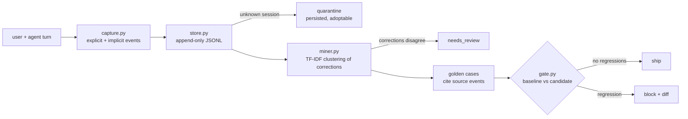

# Jagadish-agent-feedback-loop

[](https://github.com/jagadishmazure-jpg/Jagadish-agent-feedback-loop/actions/workflows/ci.yml)
[](https://github.com/jagadishmazure-jpg/Jagadish-agent-feedback-loop/actions/workflows/codeql.yml)


**A feedback flywheel for agents that runs end to end: explicit and implicit user signals land in a session-linked store, corrections are clustered into golden eval cases, and every config or model change goes through a regression gate. Synthetic data, offline.**

> Personal learning and portfolio project. Everything runs offline on synthetic,
> fictional data with no API keys. Nothing is deployed. Numbers in this README
> come from real runs and are re-checked by CI (`scripts/render_docs.py --check`).

## Recruiter summary

- Captures explicit signals (rating, thumbs, correction) and implicit ones (rephrase, tool override, abandonment), clusters corrections into golden cases that cite their source events, and blocks any change that breaks a case that used to pass.
- Real run: 7 events, 6 stored and 1 quarantined for an unknown session; 3 corrections mined into 2 golden cases; candidate A passes with 2 fixes, candidate B fails on 1 regression with a diff.
- Review fixes: quarantined events now survive a restart, and a cluster whose corrections disagree is flagged for human review before it can gate anything.

## Purpose

Agents are usually evaluated once, before launch. After that, the most useful
signal there is (users correcting answers, asking again, undoing tool calls)
gets thrown away. This repo is my working model of the loop that keeps that
signal: product usage becomes data, data becomes eval cases, and eval cases
decide whether the next change ships. It is for anyone building an agent that
has to get better after launch instead of slowly getting worse.

## Architecture



## How it works

**Capture** (`feedback/capture.py`): `FeedbackEvent` has six types, explicit
(`rating` 1-5, `thumbs`, `correction`) and implicit (`rephrase_detected`,
`tool_override`, `session_abandoned`). Each one carries `session_id`,
`turn_id` and `agent_version`. Malformed events, such as a rating of 7 or an
empty correction, raise on construction.

**Store** (`feedback/store.py`): an append-only JSONL file with query by
session, user, time and type. An event for an unregistered session is
quarantined in its own file instead of being dropped, and `adopt` links it
once the session is known.

**Mine** (`feedback/miner.py`): corrections are clustered by TF-IDF cosine
similarity of the user query (single linkage, threshold 0.35). Each cluster
becomes a `GoldenCase` that lists its source event ids. The case is marked
`needs_review` when the corrections in the cluster disagree, and cases that
duplicate the existing golden set are dropped.

**Gate** (`feedback/gate.py`): `RegressionGate` runs the baseline and the
candidate over the golden cases. It fails only on a regression (passed before,
fails now), reports fixes separately, and prints a diff for every failure.
Signal definitions and retention: `feedback/taxonomy.py`.

## Real code and output

```python
"""Feedback flywheel end to end on synthetic data: capture, store, mine golden cases, gate a change."""
import tempfile
from pathlib import Path

from feedback.capture import (
    capture_abandonment,
    capture_correction,
    capture_rephrase,
    capture_thumbs,
)
from feedback.gate import RegressionGate
from feedback.miner import CorrectionMiner, GoldenCase
from feedback.store import FeedbackStore

store = FeedbackStore(Path(tempfile.mkdtemp()) / "feedback.jsonl")
for s, u in (("s1", "u1"), ("s2", "u2"), ("s3", "u3")):
    store.register_session(s, u)

events = [
    capture_correction("s1", "t1", "agent-v1", user_query="what is the refund window for damaged items",
                       agent_answer="No refunds.", correction="30 days for damaged items"),
    capture_correction("s2", "t4", "agent-v1", user_query="refund window for damaged items please",
                       agent_answer="7 days.", correction="30 days for damaged items"),
    capture_correction("s3", "t2", "agent-v1", user_query="how do I reset my account password",
                       agent_answer="Call support.", correction="Use the reset link on the sign-in page"),
    capture_rephrase("s1", "t2", "agent-v1", user_query="refund window damaged items"),
    capture_thumbs("s2", "t5", "agent-v1", up=False),
    capture_abandonment("s3", "t3", "agent-v1"),
    capture_thumbs("s-unknown", "t1", "agent-v1", up=True),  # orphan: no registered session
]
outcomes = [store.append(e) for e in events]
print(f"Captured {len(events)} events: {outcomes.count('stored')} stored, "
      f"{outcomes.count('quarantined')} quarantined (unknown session, kept for adoption)")

existing = [GoldenCase(input="what are your opening hours", expected="9 to 5 on weekdays", case_id="faq-hours")]
mined = CorrectionMiner().mine(store.query(event_type="correction"), existing=existing)
for c in mined:
    print(f"Mined {c.case_id}: {c.input!r} -> {c.expected!r} (from {len(c.source_event_ids)} correction(s), "
          f"needs review: {c.needs_review})")
golden = existing + mined

ANSWERS_V1 = {"what are your opening hours": "9 to 5 on weekdays"}
ANSWERS_V2 = {"what is the refund window for damaged items": "30 days for damaged items",
              "how do I reset my account password": "Use the reset link on the sign-in page"}


def baseline(q):
    return ANSWERS_V1.get(q, "I am not sure.")


def candidate_good(q):
    return {**ANSWERS_V1, **ANSWERS_V2}.get(q, "I am not sure.")


def candidate_bad(q):  # fixes the mined cases but breaks opening hours
    return {**ANSWERS_V2, "what are your opening hours": "Open 24/7"}.get(q, "I am not sure.")


gate = RegressionGate()
for name, cand in (("candidate A", candidate_good), ("candidate B", candidate_bad)):
    print(f"\n{name}:\n{gate.evaluate(baseline, cand, golden).summary()}")
```

Output of `python examples/demo.py` (real run, re-checked in CI):

<!-- run: python examples/demo.py -->
```text
Captured 7 events: 6 stored, 1 quarantined (unknown session, kept for adoption)
Mined mined-68f2d9e8: 'what is the refund window for damaged items' -> '30 days for damaged items' (from 2 correction(s), needs review: False)
Mined mined-9a7a298d: 'how do I reset my account password' -> 'Use the reset link on the sign-in page' (from 1 correction(s), needs review: False)

candidate A:
gate PASS: 3 cases, 0 regressions, 2 fixes
  [pass] faq-hours
  [FIXED] mined-68f2d9e8
  [FIXED] mined-9a7a298d

candidate B:
gate FAIL: 3 cases, 1 regressions, 2 fixes
  [REGRESSED] faq-hours
    --- expected
    +++ candidate
    @@ -1 +1 @@
    -9 to 5 on weekdays
    +Open 24/7
  [FIXED] mined-68f2d9e8
  [FIXED] mined-9a7a298d
```
<!-- /run -->

## How to run

```bash
git clone https://github.com/jagadishmazure-jpg/Jagadish-agent-feedback-loop.git
cd Jagadish-agent-feedback-loop
python -m pip install pytest      # no runtime dependencies
python -m pytest -q          # offline, no keys
python examples/demo.py
python scripts/render_docs.py --check   # documented output still matches
```

Test suite size (real collection, re-checked in CI):

<!-- run: python scripts/count_tests.py -->
```text
45 tests collected
```
<!-- /run -->

## Guardrails

- Events are validated on construction; an empty correction or an out-of-range rating cannot be stored.
- Orphan events are quarantined to disk, never silently dropped.
- Mined cases cite the events they came from, so any case can be traced back to real feedback.
- Clusters with disagreeing corrections are flagged for review instead of picking an answer silently.
- The gate fails on any regression of a previously passing case, with a diff.

## Limitations

- Exact match after whitespace normalisation decides pass or fail; paraphrased correct answers fail.
- Single-linkage clustering can chain loosely related queries together at low thresholds.
- The representative correction is chosen by query similarity, so a flagged cluster still needs a person to pick the answer.
- Correction text is stored as typed; there is no PII redaction in the store (all data here is synthetic).
- A gate with zero golden cases passes; a real pipeline should require a minimum case count.
- The demo answers come from lookup tables, so it shows the gate logic, not model behaviour.

## Built vs planned

| Capability | Status | Where |
|---|---|---|
| Explicit and implicit feedback events | Built | `feedback/capture.py` |
| Append-only store with persisted quarantine | Built | `feedback/store.py` |
| Correction mining with review flag and dedup | Built | `feedback/miner.py` |
| Regression gate with diffs | Built | `feedback/gate.py` |
| Signal taxonomy and retention hooks | Built | `feedback/taxonomy.py` |
| Semantic (judge or embedding) matching in the gate | Planned | docs/implementation-guide.md |
| Warehouse-backed store and review queue | Planned | docs/implementation-guide.md |

## Threat model

| Threat | Mitigation in this repo | Status |
|---|---|---|
| Poisoned corrections steer the golden set | Source citations, review flag on disagreement; human review queue planned | Partly built |
| Silent loss of feedback | Append-only store, persisted quarantine | Built |
| A regression ships unnoticed | Regression gate with per-case diffs | Built |
| PII in free-text corrections | Not redacted here; synthetic data only | Planned |

## Interview points

- Implicit signals matter as much as explicit ones; most users rephrase or leave rather than rate.
- The gate fails on regressions, not on overall score, so a change that fixes ten things and breaks one still stops.
- Orphan events are quarantined to disk; in my first version they lived in memory and a restart lost them.

More, with likely follow-up questions: [docs/interview-points.md](docs/interview-points.md).

## Implementation guide

The step-by-step path from this offline build to an Azure deployment is in
[docs/implementation-guide.md](docs/implementation-guide.md). None of it has been
run; it is a plan.

## Related repositories

| Repo | How it relates |
|---|---|
| [Jagadish-llm-evals-observability](https://github.com/jagadishmazure-jpg/Jagadish-llm-evals-observability) | Judges, bias probes and metrics the gate could use instead of exact match |
| [Jagadish-dataset-engineering](https://github.com/jagadishmazure-jpg/Jagadish-dataset-engineering) | Annotation and decontamination for the cases this repo mines |
| [Jagadish-bank-support-agents](https://github.com/jagadishmazure-jpg/Jagadish-bank-support-agents) | Captures thumbs and corrections into its audit ledger |
| [Jagadish-retail-ops-agents](https://github.com/jagadishmazure-jpg/Jagadish-retail-ops-agents) | Same feedback capture in an operations agent |

## Documentation

- [ADR 0001: The gate fails on regressions, not on an aggregate score](docs/adr/0001-regression-only-gate.md)
- [ADR 0002: Orphan events are quarantined to disk, not dropped](docs/adr/0002-quarantine-not-drop.md)
- [The flywheel](knowledge/flywheel.md)
- [Architecture](knowledge/architecture.md)
- [Implementation guide (Azure)](docs/implementation-guide.md)
- [Interview points](docs/interview-points.md)
- [Security policy](SECURITY.md)

## Project layout

```
feedback/
  capture.py   FeedbackEvent + capture helpers
  store.py     append-only JSONL, persisted quarantine, adopt
  miner.py     TF-IDF clustering into golden cases
  gate.py      RegressionGate, per-case report, diffs
  taxonomy.py  event kinds, severity, retention
knowledge/     flywheel notes and diagrams
examples/demo.py the run shown above
tests/         offline pytest suite
```

## License

MIT, see [LICENSE](LICENSE). All data is synthetic; every organisation and person is fictional.
