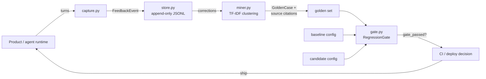
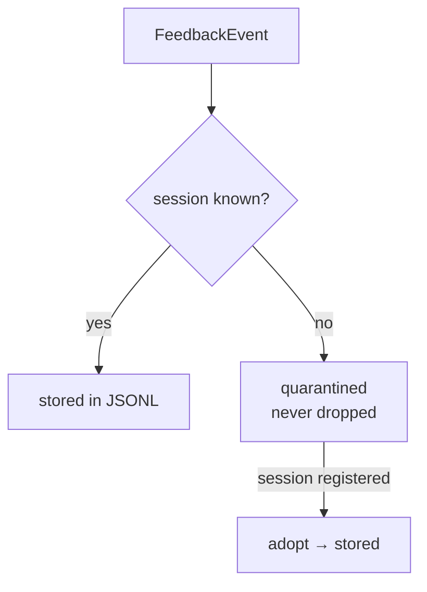
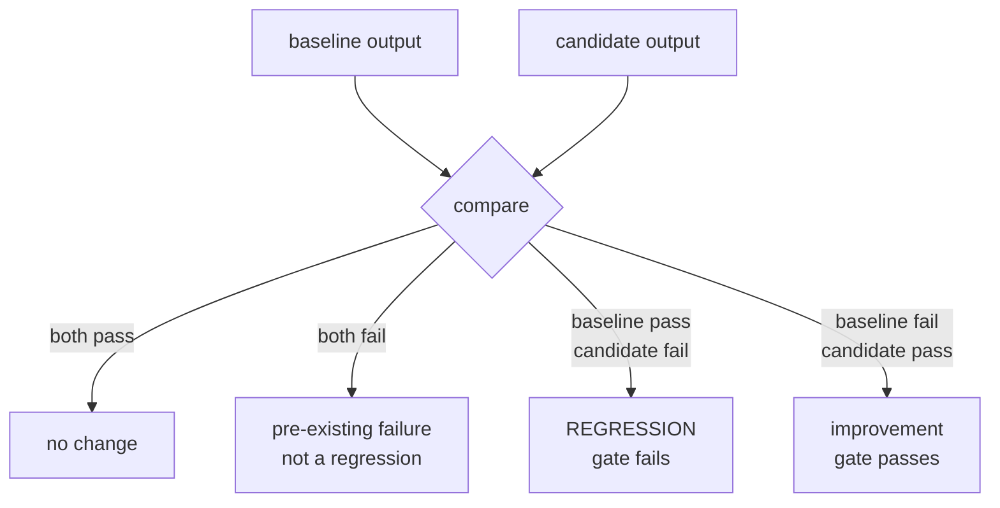

# Architecture

## The loop

## Session linkage and quarantine

Orphan events are quarantined, not dropped: a missing session id is a
pipeline bug worth noticing, not data worth losing.

## What counts as a regression

Only true regressions fail the gate: the change made something worse
than it was. Pre-existing failures and fixes are reported, not blocking.
